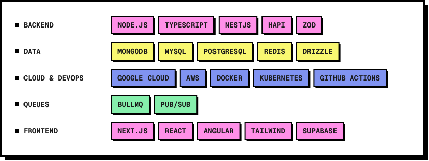
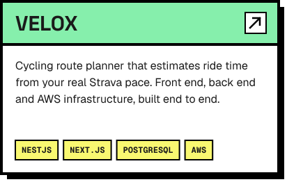
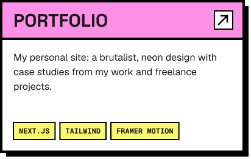

  

Backend-focused full-stack developer from Brazil. At [Squid](https://github.com/squidit) I build and maintain the Node.js + TypeScript microservices behind a creator and influencer marketing platform.

- **Day to day:** APIs, workers and ETL jobs with NestJS and Hapi, on top of MongoDB, MySQL and PostgreSQL, using queues (BullMQ, Pub/Sub) and running on Kubernetes in Google Cloud.
- **On the side:** websites and web apps with Next.js, Tailwind and Supabase, for clients and for myself.
- **Latest personal project:** Velox ([API](https://github.com/htamagnus/api-velox) and [web app](https://github.com/htamagnus/web-velox)), a cycling route planner that combines your real Strava pace with Google Maps routes to estimate time, calories and elevation. I built the front end, the back end and the whole AWS infrastructure.
- **Certified:** [AWS Certified Cloud Practitioner](https://www.credly.com/badges/8b25e9e7-d5c4-45b5-8687-a8f978fc26d1/public_url).

  

  
  

  
  

  
  
  

